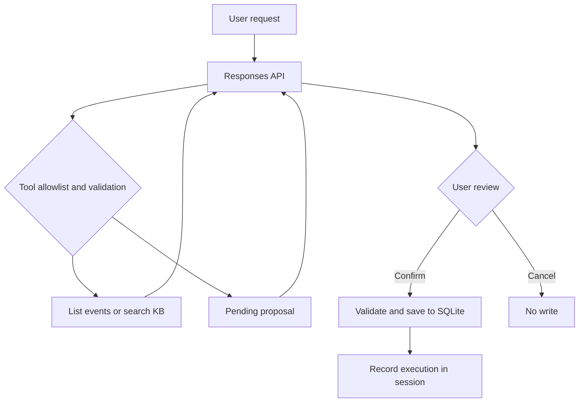

# Architecture

The LLM chooses an allowlisted function and supplies arguments. Python validates the call and returns a result. Tool proposals never write. The CLI reviews pending proposals and calls the storage implementation only after confirmation.

Module boundaries:

- `CalendarStore`: storage invariants and timezone-aware interval comparisons.
- `ToolRegistry`: strict name/key dispatch and pending proposal ownership.
- `CalendarAgent`: iterative model/tool messages, budgets and session state.
- CLI: user confirmation and application-reported execution results.

The `function_call_output` uses the matching `call_id`. All response output items are carried forward once, including any reasoning items. No tool call is assumed when the model returns text directly.

Current concurrency model is one user, one process, one SQLite connection. Conflict checking is not a cross-process transaction guarantee. Add transactional locking before serving multiple writers.
